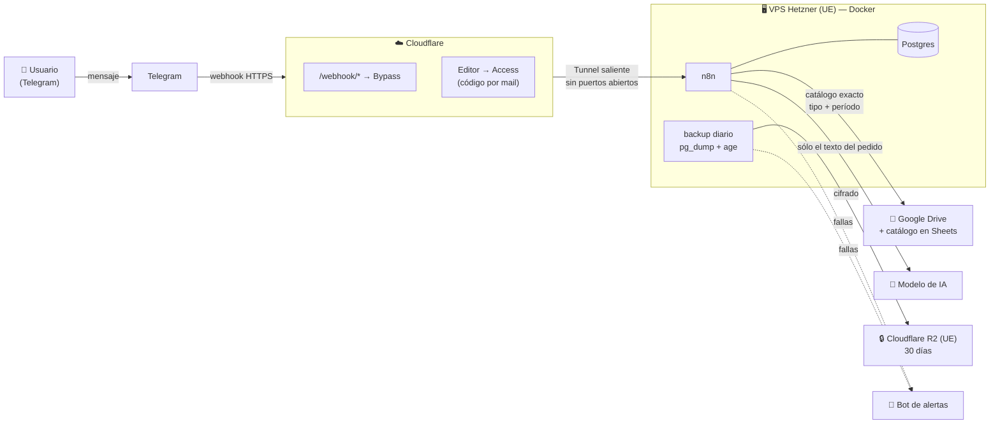

# Bot documental para contratistas

Un asistente por Telegram que le entrega a una empresa contratista sus documentos fiscales,
laborales y de seguridad **al instante y sin errores**, y le arma el **legajo mensual** que le
exigen las operadoras de Oil & Gas.

Proyecto real, en producción, para una empresa de servicios de la cuenca neuquina.
Construido con **n8n**, documentado como se construyó: qué se decidió, por qué, y qué se
rompió en el camino.

> **Estado:** fase 0 terminada — infraestructura de producción, bot conectado, backups
> cifrados con restauración probada y alertas de fallas. Próximo: el MVP (fase 1).

---

## El problema

Todos los meses, las operadoras de Oil & Gas (y las plataformas de control documental que
trabajan para ellas) le piden a cada contratista un legajo para verificar que esté en regla:
F.931 con su acuse y comprobante de pago, cuota sindical, contribuciones del convenio
petrolero, nómina del personal y de los vehículos afectados al contrato, póliza de
responsabilidad civil, plan de seguridad e higiene, registros de capacitaciones y simulacros,
reporte satelital de los conductores… **dieciséis ítems por contrato, todos los meses.**

Hoy eso se resuelve a mano: la administración le pide los papeles a la contadora, la
contadora los busca en el portal de ARCA, alguien los junta y los sube. Es el mismo llamado
todos los meses, y es fácil mandar el F.931 de mayo cuando pedían el de junio.

## La solución

Un bot de Telegram (después WhatsApp) al que se le pide en lenguaje natural:

- *"Mandame el 931 de junio"* → recibe el PDF exacto.
- *"Armame el legajo de septiembre"* → recibe un ZIP con lo que hay, y la lista de lo que falta.
- *"¿Qué falta de octubre?"* → la lista de pendientes, con quién tiene que resolver cada uno.

La contadora sólo descarga de ARCA, renombra con una convención (`2026-06_F931_DDJJ.pdf`) y lo
suelta en una carpeta. El catálogo se arma solo.

## Arquitectura

**Cómo viaja un pedido:** el mensaje entra por un webhook público (lo único abierto), pasa por
el túnel de Cloudflare hasta n8n, el modelo de IA interpreta *qué* documento se pide, una
búsqueda **exacta** en el catálogo encuentra el archivo, y el archivo va **del Drive al chat
sin pasar por el modelo**.

## Decisiones de diseño

Las más importantes; el detalle y las alternativas descartadas están en
[`docs/decisiones.md`](docs/decisiones.md).

| Decisión | Por qué |
|---|---|
| **Entregar un documento es una búsqueda exacta, no RAG** | "El F.931 de junio" se resuelve contra un catálogo (tipo + período → archivo). La búsqueda semántica encuentra lo *parecido*: devolvería el de mayo con total seguridad. |
| **El modelo nunca ve el contenido de lo que entrega** | El archivo va directo del Drive al chat. Un recibo de sueldo no le llega a ningún proveedor de IA. |
| **Lista blanca por `user_id` numérico de Telegram** | Un bot de Telegram es público. El `@username` se puede cambiar; el ID no. |
| **Permisos por tercero, con invitaciones de un solo uso** | Una operadora tiene derecho a ver el F.931 de su contratista; otro proveedor no. Una clave compartida se reenvía y no se sabe quién la usó. |
| **Canal separado del núcleo** | El workflow de Telegram sólo normaliza el mensaje. Sumar WhatsApp no toca la lógica. |
| **Cero puertos abiertos para n8n** | Cloudflare Tunnel sale desde el servidor. Desde internet no hay forma de llegar a n8n salvo por Cloudflare. |
| **Servidor y backups en la Unión Europea** | La UE tiene protección "adecuada" para la Ley 25.326 de datos personales; EE. UU. no. Son datos de empleados. |

## Seguridad, en capas

1. **Servidor**: acceso sólo por SSH con clave; `root` y contraseñas deshabilitados; firewall
   con un único puerto abierto (22); actualizaciones de seguridad automáticas.
2. **n8n**: escucha sólo dentro del servidor (`127.0.0.1`). El editor está detrás de
   Cloudflare Access (código de un solo uso por mail). Sólo `/webhook/*` queda público, y cada
   webhook de Telegram lleva un token secreto.
3. **Bot**: lista blanca por `user_id`, sin grupos, niveles de acceso por tipo de documento y
   registro de cada pedido con `trace_id`.
4. **Datos**: el modelo de IA sólo ve el texto del pedido. Nada con datos personales se indexa
   en un RAG.
5. **Backups**: diarios, **cifrados con [age](https://age-encryption.org) antes de salir del
   servidor**. El servidor sólo tiene la clave pública: aunque alguien entrara al servidor o al
   bucket, no podría leer ningún backup.
6. **Alertas**: cualquier falla de n8n o del servidor llega por Telegram en segundos.

## Lo que se rompió (y cómo se encontró)

La [bitácora](docs/bitacora.md) registra cada problema real con su síntoma, su causa y su
arreglo. Dos ejemplos de la fase 0:

- **El bot no respondía, y el error hablaba de "entidades".** El nodo de Telegram de n8n manda
  Markdown por defecto, y el guion bajo de `user_id` abrió una cursiva que nunca se cerró. Los
  archivos del catálogo se llaman `2026-06_F931_DDJJ.pdf`: con Markdown, el bot habría fallado
  al nombrar *cualquier* documento. Regla: todo en HTML.
- **El backup funcionaba… al segundo intento.** El rclone que trae Ubuntu (de 2022) hace una
  operación que R2 hoy no implementa. Andaba por los reintentos; el día que fallaran los tres,
  no habría backup y nadie se enteraría.

## Fases

| Fase | Qué | Estado |
|---|---|---|
| 0 | Infraestructura de producción, bot conectado, backups y alertas | ✅ |
| 1 | MVP: catálogo automático desde el Drive, entrega por tipo y período, legajo como ZIP | ⏳ |
| 2 | Carga de documentos mandándolos al bot | |
| 3 | Estado del legajo y recordatorios mensuales | |
| 5 | Acceso de terceros (operadoras) con permisos por documento | |
| 6 | Constancia de ARCA automática por webservice | |
| 8 | Canal de WhatsApp | |

## Stack y costos

| | | Costo mensual |
|---|---|---|
| Orquestación | n8n 2.29 (self-hosted) + Postgres 17, en Docker | — |
| Servidor | Hetzner Cloud, 2 vCPU / 2 GB, Helsinki | ~USD 14 (con backups del disco e IPv4) |
| Red y acceso | Cloudflare Tunnel + Access + DNS | USD 0 |
| Backups | Cloudflare R2 (UE), cifrado con age | USD 0 (dentro del plan gratuito) |
| Canal | Telegram Bot API | USD 0 |

## Usar la infraestructura

La carpeta [`infra/`](infra/) es reutilizable para cualquier n8n en producción:

- `docker-compose.yml`: n8n + Postgres + cloudflared, n8n escuchando sólo en `127.0.0.1`.
- `backup/`: backup diario cifrado a R2 con timer de systemd, y alerta por Telegram si falla.
- `workflows/`: el Error Workflow que avisa de fallas por Telegram.

Los secretos nunca van en el repo: cada archivo `.env.example` dice qué completar.

---

Hecho por **Ignacio Paiva** — [Traza el Impacto](https://trazaelimpacto.com) ·
Automatización con IA para empresas.

El caso es real; los datos del cliente están anonimizados.
